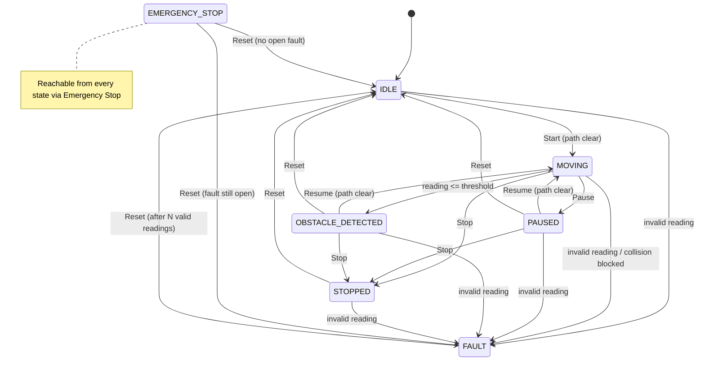

# MobilityBot state machine (Stage 1, simulation)

The controller (`src/controller.py`) is the only code that changes robot state.
Every change goes through `RobotController._transition`, which raises
`InvalidTransitionError` for anything not in `ALLOWED_TRANSITIONS`.
`tests/test_controller.py::test_transition_table_is_enforced` checks all 49
state pairs.

## States

| State | Robot moving? | Meaning |
|---|---|---|
| `IDLE` | No | Ready. The only state that accepts **Start**. |
| `MOVING` | Yes | Driving. The only state in which the simulator moves the robot. |
| `PAUSED` | No | Halted by the user (**Pause**). |
| `OBSTACLE_DETECTED` | No | A valid reading was at or inside the stop threshold. **Latched**: it stays here when the obstacle goes away. |
| `STOPPED` | No | Run ended by the user (**Stop**). Needs **Reset** before a new **Start**. |
| `EMERGENCY_STOP` | No | Software e-stop. Highest priority. Rejects everything except **Reset**. |
| `FAULT` | No | Invalid sensor reading, or the simulator blocked a collision the sensor missed. Needs a recovery sequence. |

## Permitted transitions

| From | To | Trigger | Condition |
|---|---|---|---|
| IDLE | MOVING | Start | Fresh reading is CLEAR and the first step does not collide |
| IDLE | EMERGENCY_STOP | Emergency Stop | always |
| IDLE | FAULT | Invalid reading | automatic |
| MOVING | PAUSED | Pause | always |
| MOVING | STOPPED | Stop | always |
| MOVING | STOPPED | Navigation: destination reached, or route blocked | automatic (navigation only *requests* this end of run) |
| MOVING | OBSTACLE_DETECTED | Reading ≤ threshold | automatic |
| MOVING | EMERGENCY_STOP | Emergency Stop | always |
| MOVING | FAULT | Invalid reading, or next step would collide | automatic |
| PAUSED | MOVING | Resume | Fresh reading is CLEAR and the first step does not collide |
| PAUSED | STOPPED | Stop | always |
| PAUSED | IDLE | Reset | always |
| PAUSED | EMERGENCY_STOP / FAULT | E-stop / invalid reading | as above |
| OBSTACLE_DETECTED | MOVING | Resume | Fresh reading is CLEAR (the obstacle has really gone) |
| OBSTACLE_DETECTED | STOPPED | Stop | always |
| OBSTACLE_DETECTED | IDLE | Reset | always |
| OBSTACLE_DETECTED | EMERGENCY_STOP / FAULT | E-stop / invalid reading | as above |
| STOPPED | IDLE | Reset | always |
| STOPPED | EMERGENCY_STOP / FAULT | E-stop / invalid reading | as above |
| EMERGENCY_STOP | IDLE | Reset | No unresolved fault |
| EMERGENCY_STOP | FAULT | Reset | An earlier fault is still unresolved (e-stop can't be used to skip fault recovery) |
| FAULT | IDLE | Reset | At least `fault_recovery_readings` (default 3) **consecutive valid** readings recorded in simulation steps since the fault |
| FAULT | EMERGENCY_STOP | Emergency Stop | always |

Everything else is rejected and logged as a `WARNING`. In particular:

* Navigation (`src/navigation.py`) adds **no** states or transitions. It only supplies the motion
  command for a `MOVING` step. The controller clamps it and runs all the usual checks first.
  Planning a route never changes state.
* Only **Start** and **Resume** can lead to `MOVING`. Ticks, resets, clearing an
  obstacle, auto-run, changing settings and dashboard reruns cannot.
* **Reset** always ends in `IDLE` or `FAULT`, never in `MOVING`.
* While in `EMERGENCY_STOP`, sensor problems are recorded but don't change state.
  After Reset, the next reading is checked as usual.
* An invalid reading during fault recovery sets the count back to zero.

## Sensor validity rules (`src/safety.py`)

A reading is **CLEAR** only if it is a real, finite number (not a bool or string),
within the sensor's valid range (default 0.02–4.00 m), and **strictly greater**
than the stop threshold. A valid reading **at or below** the threshold is an
**OBSTACLE**. Anything else (None/no echo, NaN, ±infinity, negative, below min, above max,
wrong type) is **INVALID** and is never treated as a clear path.
